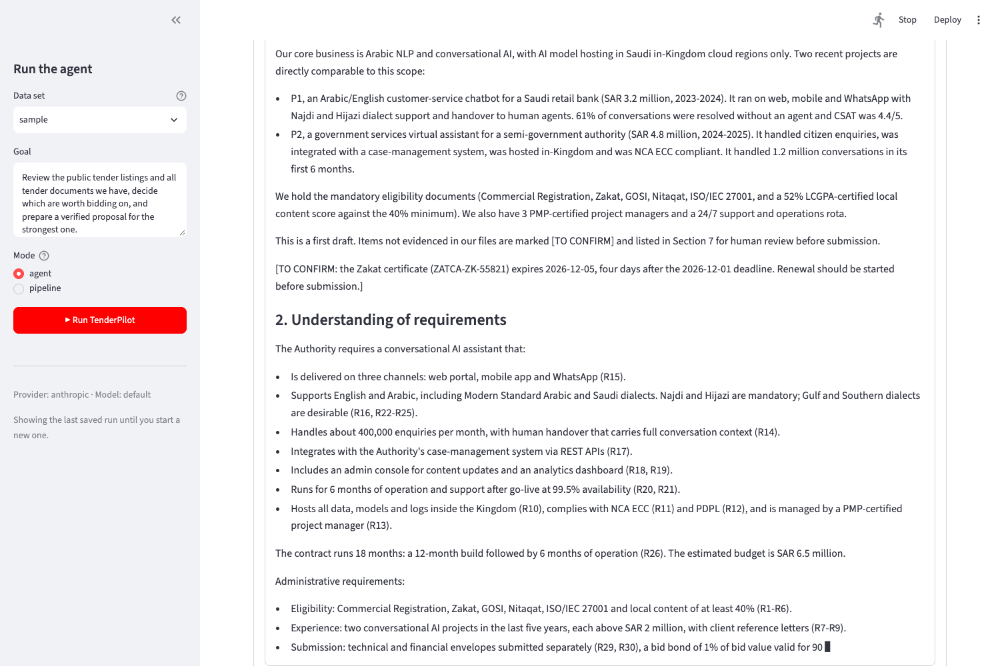
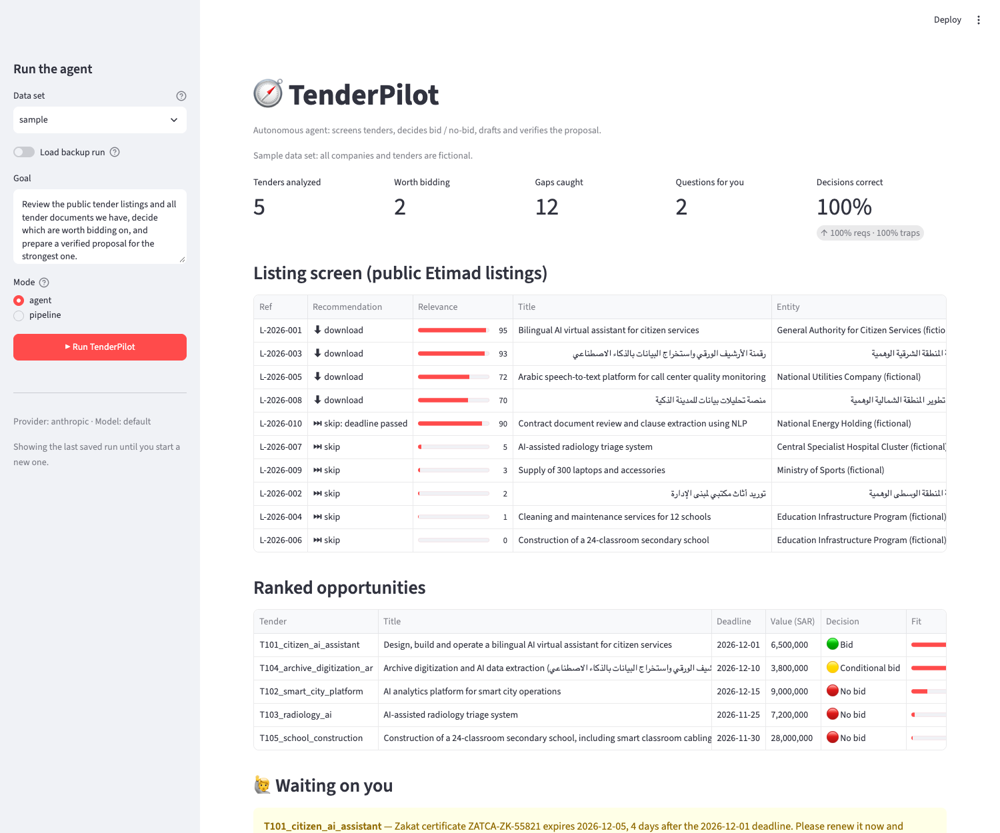
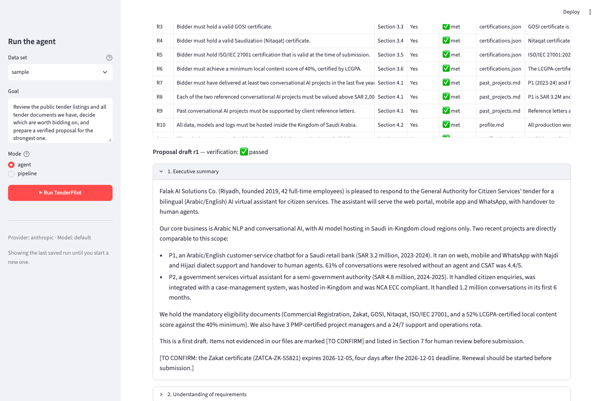

# TenderPilot
**Autonomous AI agent that finds tenders, decides bid/no-bid, and drafts compliant proposals end-to-end.**

Built for the HUMAIN Hackathon, Challenge 3: Autonomous Enterprise.

Companies spend days reading each government or enterprise tender, checking eligibility,
and writing compliance matrices, and one missed clause in an appendix can disqualify a bid.
TenderPilot takes ownership of that process: give it a goal, and it reviews every open tender,
checks each requirement against the company's own evidence, ranks the opportunities, writes and
self-verifies a proposal, and only asks a human when a human decision is needed.

It runs on two data sets:
- `data/sample/`: a **fictional** company and 5 tenders with planted traps, plus an answer key, for the demo
- `data/my_company/`: a template for a **real** company and **real** tenders downloaded from Etimad
  (see [`data/my_company/HOW_TO_USE.md`](data/my_company/HOW_TO_USE.md))

## Tech stack

- **Python 3.11**
- **Claude API** through the `anthropic` SDK (model `claude-sonnet-5-5`); switchable to any OpenAI-compatible model
- **Streamlit** for the web app
- **Pydantic** to validate every structured output from the model
- **PyMuPDF**, **python-docx** and **openpyxl** to read tender documents (PDF, Word, Excel) and write the proposal in Word
- **hijridate** for Hijri deadlines (Umm al-Qura calendar)
- **SQLite** for the tender tracker and audit log
- Deployed on **Streamlit Community Cloud**

## How it works

```
 Goal ──► Orchestrator (LLM with tools) ──► finish + briefing
              │
   ┌──────────┼───────────────────────────────────────────────┐
   │ 0 screen_listings     score public Etimad listings → which documents to download
   │ 1 list_tenders        find tender packs (PDF/DOCX/XLSX/MD, Arabic + English)
   │ 2 extract_requirements  every requirement → structured JSON (incl. appendices)
   │ 3 qualify_tender      check each requirement vs company files → BID / CONDITIONAL / NO_BID
   │ 4 rank_opportunities
   │ 5 draft_proposal      proposal + compliance statement + open items
   │ 6 verify_proposal     critic pass; fails → redraft (max 3)
   │ 7 request_human_input only for things a human must decide
   └──────────────────────────────────────────────────────────┘
        ▲ company knowledge (data/company)    ▼ tracker + audit log (SQLite), .docx export
```

**Guardrails in plain Python, so the model can't skip them:**
- A requirement can only be `met` if the model cites a real company file as evidence.
- Certificates that expire before a tender's deadline are caught automatically and turn a BID into a CONDITIONAL_BID.
- Every mandatory requirement must appear in the proposal, and every gap must be listed for human review, or verification fails and the agent redrafts.
- Deadlines are normalized (Hijri and Arabic-Indic digits converted); a passed deadline means NO_BID, a missing one must be confirmed.

**Built for real tender packs:** multi-file tenders (booklet + appendices + BOQ), long PDFs read in parts
and merged without duplicates, OCR fallback for scanned Arabic pages, and `meta.json` overrides from the Etimad page.

## The demo scenario

| Tender | Trap planted | Correct call |
|---|---|---|
| T101 Citizen AI assistant | none, strong fit | **BID** |
| T102 Smart city platform | mandatory CMMI Level 3 hidden in Appendix B | **NO BID** |
| T103 Radiology AI | needs SFDA authorization + 10 years in healthcare | **NO BID** |
| T104 Archive digitization (Arabic) | Zakat certificate expires before the deadline | **CONDITIONAL BID** |
| T105 School construction | out of scope, needs contractor classification | **NO BID** |

`answer_key.json` holds the correct answers; `eval.py` scores each run on decisions,
requirement recall and traps caught.

## Live demo

**[TenderPilot on Streamlit Community Cloud](https://tenderpilot-demo.streamlit.app/)**

The public app opens on a saved run of the fictional sample data. Visitors can switch off **Load backup run** to
start a live run; live runs are limited to 30 per day, one at a time, at most one every 2 minutes.

To try **Upload a tender** with documents the agent has never seen, use the four fictional tenders in
[test_tenders/](test_tenders/README.md) (two in Arabic; U3 is split over two files). The expected results are in
[test_tenders/EXPECTED_RESULTS.md](test_tenders/EXPECTED_RESULTS.md).

## Results

Sample data (5 tenders, 10 listings), scored by `eval.py` against `answer_key.json`, model `claude-sonnet-5-5`:

| Mode | Decisions correct | Requirement recall | Traps caught | Run time |
|---|---|---|---|---|
| Pipeline (`--mode pipeline`) | 100% | 100% | 100% | ~150 s |
| Agent (`python run.py`) | 100% | 100% | 100% | ~180 s |
| Agent in the UI (streamed draft) | 100% | 100% | 100% | ~130–150 s |

The 5 tenders are extracted and qualified in parallel (about 50 s in total, down from about 130 s one at a time).
Most of the remaining time is the single proposal-drafting call, which the UI streams live.
Run times vary with API load.

| Proposal written live | Ranking and listing screen | Compliance matrix with cited evidence |
|---|---|---|
|  |  |  |

## Setup

You need **Python 3.11** and an **Anthropic API key**.

```bash
python -m venv .venv
source .venv/bin/activate        # Windows: .venv\Scripts\activate
pip install -r requirements.txt
cp .env.example .env             # Windows: copy .env.example .env
```

Then open `.env` and set `ANTHROPIC_API_KEY` to your key. The key is only read from `.env`, which is never committed.

## How to run

```bash
streamlit run app.py --server.address localhost   # then open http://localhost:8501
```

`--server.address localhost` keeps the app on your machine; without it, Streamlit also serves it to your local
network. (The setting is on the command line, not in `.streamlit/config.toml`, because that file is shared
with the cloud deployment, which must be reachable.) The app does not open a browser tab itself.
If the API or Wi-Fi fails during a demo, switch on **Load backup run** in the sidebar to show the saved run in `demo_backup/`.

To analyze one tender of your own, pick **Upload a tender** as the data set. Add all of the tender's files
(booklet, appendices, BOQ; PDF, DOCX, XLSX, MD or TXT; up to 25 MB each and about 150 pages in total), optionally
a title, deadline (Gregorian or Hijri) and value, choose the company profile, and press **Analyze this tender**.
Files are kept in a temporary folder for your browser session (`output/uploads/`, never committed) and are
sent to the AI provider for analysis.

To close the loop on a question in **Waiting on you**, type the answer and press **Send** (e.g. "Zakat renewed,
new certificate valid until 2027-12-01"). The answer is recorded in the audit log and added to the company
knowledge for that run (`bid_manager_answers.md`, which the agent can cite; files on disk are not changed). The
agent re-qualifies that tender, and if it becomes a BID, it drafts and verifies the proposal. A certificate's
expiry date is only updated when the answer names exactly one certificate and one date.

Other commands:
- `python run.py` runs the autonomous agent from the CLI, on the sample data
- `python run.py --mode pipeline` runs the fixed-order fallback
- `python run.py --data data/my_company` runs on your company and real tenders
- `python eval.py` scores the last run

Works with Claude (default) or any OpenAI-compatible endpoint: set `LLM_PROVIDER=openai`
and `OPENAI_BASE_URL` in `.env`.

## How to test

**1. Offline tests (no API key needed):**

```bash
python tests/test_flow.py
```

A deliberately careless fake model runs the full workflow, and the tests check that the
guardrails catch its mistakes (expired Zakat certificate, missing evidence, a forgotten
requirement that forces a redraft, a bad tool call the agent recovers from), that parallel tool
calls extract each tender only once, that a broken draft stream falls back to a normal call, and that a
30-page multi-file PDF pack with a clause hidden in its appendix and a Hijri deadline is read correctly.

**2. Accuracy against the answer key (needs the API key):**

```bash
python run.py      # a real run on the sample data
python eval.py     # scores that run against answer_key.json
```

`eval.py` reports the share of correct BID / CONDITIONAL / NO_BID decisions, requirement recall and traps caught
(see [Results](#results)).

**3. Uploads with unseen tenders:** in the app, pick **Upload a tender**, keep the **sample** company profile, and
upload the fictional tenders in [test_tenders/](test_tenders/README.md) one at a time (U3 is two files, uploaded
together). Compare the decisions with [test_tenders/EXPECTED_RESULTS.md](test_tenders/EXPECTED_RESULTS.md).

## Project layout

```
agent/
  llm.py        model wrapper (Claude or OpenAI-compatible), JSON validation, tool calling
  schemas.py    Pydantic models passed between stages
  documents.py  tender packs (PDF/DOCX/XLSX/MD, OCR fallback), chunking, Hijri dates, company knowledge
  listings.py   public tender listings (listings.csv)
  tools.py      the agent's tools + guardrails
  loop.py       autonomous orchestrator and fixed pipeline
  store.py      SQLite tracker and audit log
  run_budget.py daily cap and cooldown for live runs on the public demo
  export.py     proposal → Word with compliance matrix
app.py          Streamlit UI
run.py          CLI
eval.py         scoring against answer_key.json
data/sample/    fictional company, tenders, listings
data/my_company/ template for your real company and tenders
demo_backup/    a saved good run of the sample data ("Load backup run")
docs/           screenshots
.streamlit/     theme config, secrets.toml.example (for Streamlit Cloud)
```

## Next steps

- **Run on HUMAIN's in-Kingdom models**, so tender and company data stay in Saudi Arabia (the model is already
  switchable through the OpenAI-compatible setting)
- **Arabic proposals**, written in the tender's language
- **A pilot on real Etimad tenders** with a registered Saudi company and its real documents
- **An approved tender data feed** instead of copying listings by hand
- **Accounts and team review**: sign-in, roles, and a bid manager approving each proposal before submission

## Built with

Designed by me (j-mud). Built with [Claude Code](https://claude.com/claude-code) as a coding assistant.
